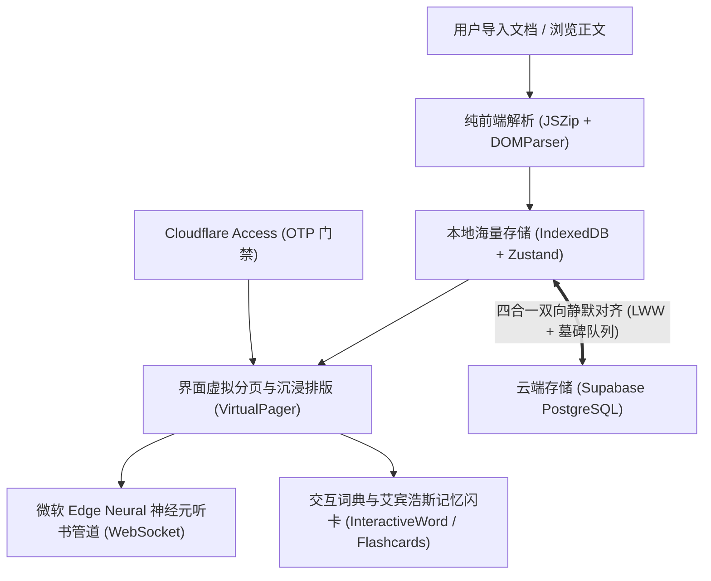

# Offline-First Reader & Media Learning Architect (离线优先跨端双语阅读器与媒体学习应用架构师)

本 Skill 沉淀自沉浸式双语阅读器 (Immersive Reader) 的全栈实战开发经验。
它专用于指导开发者从零构建或重构具备**绝对离线优先、海量本地存储、四合一无感云漫游、微软 Edge Neural 高保真神经元发声管道与纯前端富文本解析**的高性能阅读与语言学习类应用。

---

## 核心设计范式与执行指南

### 1. 突破存储壁垒：离线优先存储体系 (Offline-First Storage)
- **拒绝 LocalStorage**：LocalStorage 受限于 5MB 同步阻塞配额，存储整本几十万字小说极易崩溃；
- **IndexedDB + Zustand 黄金组合**：
  - 引入 `idb-keyval` 作为 Zustand 的异步存储适配器；
  - 数据结构严格分离：`bookshelf`（书籍大文本）、`vocabulary`（生词字典）、`readingProgress`（进度及毫秒时间戳）、`notes`（读书笔记）、`deletedQueues`（防复活墓碑队列）；
  - 详见：[IndexedDB 离线存储实现指南](./references/offline_storage_idb.md)。

---

### 2. 四合一多端静默漫游引擎 (Cross-Device Cloud Sync)
实现类似“微信读书”的跨设备无感漫游（如电脑导入，手机打开书架即读），必须同时满足四大法则：
1. **复合主键隔离**：云端所有表均使用 `(user_email, item_id)` 建立复合唯一键，保障用户隔离与幂等；
2. **最新进度胜出仲裁 (Last-Write-Wins, LWW)**：
   - 翻页防抖向本地与云端带时间戳上报；
   - 切换或启动时比对毫秒时间戳，云端时间戳更新则自动静默跳转并 Toast 提示用户；
3. **墓碑删除队列防复活 (`deletedQueues`)**：
   - 本地设立删除追踪队列，同步时优先向云端发批量删除指令，随后拉取时过滤该队列，彻底杜绝已删数据在对端被拉回复活；
4. **存量数据全量自动补推 (Auto Push Existing Books)**：
   - 启动或点击同步时，自动扫描本地未标记同步的离线书籍与笔记，全量 UPSERT 补推上云，实现闭环；
  - 详见：[四合一双向同步与 LWW 仲裁指南](./references/cloud_sync_and_lww.md)。

---

### 3. 微软 Edge Neural 高保真发声管道 (Edge TTS Pipeline)
彻底告别传统浏览器原生 Web Speech API 机械呆板的声音，直连微软顶流自然发音人（如 `en-US-AvaMultilingualNeural`）：
1. **纯前端 Sec-MS-GEC 防刷鉴权**：
   - 使用 Web Crypto API（`crypto.subtle.digest`）计算基于 Windows File Time（向下取整 300 秒）与 TrustedClientToken 的 SHA-256 哈希；
2. **短句切片与管道并发预加载 (Pipeline Prefetch)**：
   - 长段落单次发送 SSML 会超出 WebSocket 缓冲区导致卡死断流；
   - 文本 $\le 100$ 字符单句直发；长文本按标点 `[.!?;\n]` 安全切分短句；
   - **播第 1 句的同时，后台异步并发请求第 2 句并缓存其 MP3 Blob**，整段朗读零停顿连读，首句响应提速至 200~400ms 极速秒开；
3. **会话隔离与毫秒级打断**：
   - 引入 `currentSessionId` 与 WebSocket 集合；点击暂停或切段时，瞬间递增 ID 并 `ws.close()`，旧音频注销，绝不串音；
4. **双轨无缝降级**：
   - 设置 6 秒熔断，极端弱网或受限浏览器环境下自动无感降级到原生语音，永不卡死失声；
  - 详见：[Edge TTS 协议与预加载管道开发指南](./references/edge_tts_pipeline.md)。

---

### 4. 纯前端富文档解析引擎 (Client-Side Parser)
- **TXT 引擎**：按换行符智能归拢段落、清洗空白字符，输出分页器可消费的数组；
- **EPUB 引擎 (`JSZip` + `DOMParser`)**：
  - 纯前端内存解压 `container.xml` 与 `content.opf`，按 Spine 拓扑排序解析章节；
  - 遍历抽取章节内所有图片资源，即时转码为 `data:image/...;base64` 回填 `` 标签，实现整本图书带图永久离线存储；
  - 详见：[纯前端 EPUB 解析与图片离线化指南](./references/epub_parser_guide.md)。

---

### 5. 移动端触控人体工学与沉浸交互
- **纯净阅读与轻触唤出**：
  - 手机端默认隐藏所有段落工具栏；
  - 手指轻触段落时，工具栏平滑展开于段落正上方（不遮挡文本首行）；再次轻触即可收起；
- **36px 防误触点击热区**：
  - 工具栏按钮全部设为 `min-w-[36px] min-h-[36px]`，间距扩至 `gap-2.5`；
- **事件冒泡严格拦截**：
  - 查词发音、气泡弹窗与工具栏所有按钮严格执行 `e.stopPropagation()`，杜绝操作时意外触发折叠。

---

## 验证与验收准则 (Acceptance Checklist)

当使用本模式开发应用时，必须通过以下验收项：
- [ ] **断网可用性**：拔掉网线或离线模式下，本地已导入书籍仍可秒开、翻页与查词；
- [ ] **多端对齐**：Mac 导入一本书并读到第 30 页，iPhone 登录相同白名单邮箱，书架自动出现该书并提示恢复到第 30 页；
- [ ] **删除防复活**：在一台设备上删除一本书或一个单词，同步后不会被另一台设备重新拉回；
- [ ] **长音频流畅度**：长段落点击发音，0.5 秒内首句响起，全段朗读句子之间无明显卡顿等待；
- [ ] **打断可靠性**：朗读中途点击暂停，声音立即停止，后台无残留请求，绝不串音；
- [ ] **移动端手感**：手机单手大拇指快速点击“译”或“发音”，绝不误触临近按钮，且点单词查词不影响工具栏展开。
