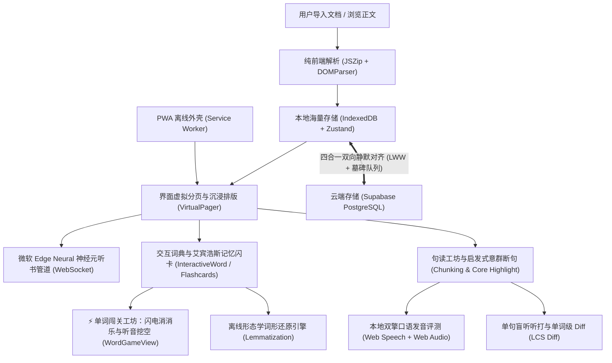

# Offline-First Reader & Media Learning Architect (离线优先跨端双语阅读器与媒体学习应用架构师)

本 Skill 沉淀自沉浸式双语阅读器 (Immersive Reader v2.5.0) 的全栈实战开发经验。
它专用于指导开发者从零构建或重构具备**绝对离线优先、海量本地存储、四合一无感云漫游、微软 Edge Neural 高保真神经元发声管道、纯前端富文本解析、句读意群断句、本地双擎口语打分、⚡单词闯关双模式实训与形态学词形还原**的高性能阅读与语言深度研磨类应用。

---

## 核心设计范式与系统全景

---

## 十一核心工程系统与执行指南

### 1. 突破存储壁垒：离线优先存储体系 (Offline-First Storage)
- **拒绝 LocalStorage**：LocalStorage 受限于 5MB 同步阻塞配额，存储整本几十万字小说极易崩溃；
- **IndexedDB + Zustand 黄金组合**：
  - 引入 `idb-keyval` 作为 Zustand 的异步存储适配器；
  - 数据结构严格解耦：`bookshelf`（书籍大文本）、`vocabulary`（生词字典）、`readingProgress`（进度及毫秒时间戳）、`notes`（读书笔记）、`deletedQueues`（防复活墓碑队列）；
  - 详见：[IndexedDB 离线存储实现指南](./references/offline_storage_idb.md)。

---

### 2. 四合一多端静默漫游引擎 (Cross-Device Cloud Sync)
实现类似“微信读书”的跨设备无感漫游（电脑导入，手机打开书架即读），必须同时满足四大法则：
1. **复合主键隔离**：云端所有表均使用 `(user_email, item_id)` 建立复合唯一键，保障用户隔离与幂等；
2. **最新进度胜出仲裁 (Last-Write-Wins, LWW)**：
   - 翻页防抖向本地与云端带时间戳上报；
   - 切换或启动时比对毫秒时间戳，云端时间戳更新则自动静默跳转并 Toast 提示用户；
3. **墓碑删除队列防复活 (`deletedQueues`)**：
   - 本地设立删除追踪队列，同步时优先向云端发批量删除指令，随后拉取时过滤该队列，杜绝已删数据在对端被拉回复活；
4. **存量数据全量自动补推 (Auto Push Existing Books)**：
   - 启动或点击同步时，自动扫描本地未标记同步的离线书籍与笔记，全量 UPSERT 补推上云，实现闭环；
  - 详见：[四合一双向同步与 LWW 仲裁指南](./references/cloud_sync_and_lww.md)。

---

### 3. 微软 Edge Neural 高保真发声管道 (Edge TTS Pipeline)
直连微软顶流自然发音人（如 `en-US-AvaMultilingualNeural`），具备极具感染力的呼吸感与连读抑扬顿挫：
1. **纯前端 Sec-MS-GEC 防刷鉴权**：
   - 使用 Web Crypto API（`crypto.subtle.digest`）计算基于 Windows File Time（向下取整 300 秒）与 TrustedClientToken 的 SHA-256 哈希；
2. **短句切片与管道并发预加载 (Pipeline Prefetch)**：
   - 长段落按标点 `[.!?;\n]` 安全切分短句；
   - **播第 1 句的同时，后台异步并发请求第 2 句并缓存其 MP3 Blob**，整段朗读零停顿连读，首句响应提速至 200~400ms 极速秒开；
3. **会话隔离与毫秒级打断**：
   - 引入 `currentSessionId` 与 WebSocket 集合；点击暂停或切段时，瞬间递增 ID 并 `ws.close()`，旧音频注销，绝不串音；
4. **双轨无缝降级**：
   - 设置 6 秒熔断，极端弱网或受限浏览器环境下自动无感降级到原生语音；
  - 详见：[Edge TTS 协议与预加载管道开发指南](./references/edge_tts_pipeline.md)。

---

### 4. 纯前端富文档解析引擎 (Client-Side Parser)
- **TXT 引擎**：按换行符智能归拢段落、清洗空白字符，输出分页器可消费的数组；
- **EPUB 引擎 (`JSZip` + `DOMParser`)**：
  - 纯前端内存解压 `container.xml` 与 `content.opf`，按 Spine 拓扑排序解析章节；
  - 遍历抽取章节内所有图片资源，即时转码为 `data:image/...;base64` 回填 `` 标签，实现整本图书带图永久离线存储；
  - 详见：[纯前端 EPUB 解析与图片离线化指南](./references/epub_parser_guide.md)。

---

### 5. 移动端触控人体工学与二阶自适应收纳 (Mobile Adaptive UI)
- **纯净阅读与轻触按需唤出**：手机端默认隐藏段落工具栏，轻触段落平滑展开，再触收起；
- **高频主行 + ⋯ 更多二级抽屉**：
  - 主行常驻高频操作（🔊 朗读、译 翻译、🔍 句读、⋯ 更多）；
  - 二级抽屉展开低频操作（🎧 段落听写、🔖 书签、📝 随笔），杜绝 375px 小屏挤压或错位折行；
- **36px 防误触点击热区**：按钮统一 `min-w-[36px] min-h-[36px]`，且点词事件严格阻止冒泡；
- **动态视口高度适配 (`100dvh`)**：弹窗与精读面板采用 `h-[100dvh]`，防止软键盘弹起遮挡输入框与操作栏；
  - 详见：[移动端自适应控制台、视口适配与性能守恒指南](./references/mobile_adaptive_ui_and_performance.md)。

---

### 6. 句读精读台与启发式意群断句 (Chunking & Core Highlight)
- **正规分句器**：负向先行断言结合缩写白名单保护（`Mr.`, `Dr.`, `e.g.`, `U.S.`），精准切分子句；
- **启发式意群划分 (Chunking)**：
  - 自动识别介词短语、从句引导词、动词不定式及停顿标点，切分为带有轻量斜线自然分隔的节奏块，降低阅读视幅心智负担；
- **主干语义高亮 (Core Semantic Highlight)**：
  - 提取主干主谓宾骨架，附加琥珀加粗高亮，剥除从句干扰；
- **全键盘盲操快捷流**：支持 <kbd>Space</kbd>、<kbd>R</kbd>、<kbd>J</kbd>、<kbd>K</kbd>、<kbd>D</kbd>、<kbd>Esc</kbd> 极速流转；
  - 详见：[句读精读台与启发式意群断句指南](./references/sentence_reader_and_chunking.md)。

---

### 7. 本地双擎口语发音评估与三色诊断 (Speech Evaluation Engine)
- **无外部依赖的 Web 双引擎架构**：
  - **引擎 A (Web Speech API)**：实时英文连续识别，提取候选词与置信度；
  - **引擎 B (Web Audio API)**：20fps 高频采集 RMS 声学音量包络，计算有效发声比率与停顿；
- **多维综合评分模型**：
  - 准确率 (60%): 最长公共子序列 (LCS) + Levenshtein 动态规划形似度；
  - 流利度 (25%): 实际 WPM 对比与静音停顿惩罚；
  - 完整度 (15%): 目标词覆盖率；
- **音素级红黄绿三色信号灯**：🟢 `excellent` / 🟡 `good` / 🔴 `needs_work` 逐词诊断呈现；
- **正文单词查词弹窗无缝复用**：支持单生词现场跟读评测；
  - 详见：[本地双擎口语发音评测与听打 Diff 引擎指南](./references/speech_eval_and_dictation_diff.md)。

---

### 8. 单句盲听听打与单词级最小编辑距离 Diff (Sentence Dictation)
- **盲听遮罩与原音循环**：单句正文隐去，Ava 原音循环播放；
- **Word-level LCS Diff 差分算法**：
  - 动态规划计算最小编辑距离，生成 `match`（绿色药丸）、`insert`（红色删除线）、`delete`（虚线原词提示）三色标记；
- **生词一键收纳**：听打错词一键录入 IndexedDB 生词本；
  - 详见：[本地双擎口语发音评测与听打 Diff 引擎指南](./references/speech_eval_and_dictation_diff.md)。

---

### 9. 真·全功能飞行模式与形态学词形还原 (Lemmatization)
- **PWA Service Worker 离线外壳**：Cache-First 与 Stale-While-Revalidate，机舱断网秒开绝无恐龙页面；
- **形态学词形还原 (Morphological Lemmatizer)**：
  - 覆盖不规则动词字典、复数三单（`-ies`, `-ves`, `-es`）、过去式分词（`-ied`, `-ed`, 双写还原）、进行时（`-ing`, `-ying`）及副词还原；
- **四级穿透离线查词**：`会话缓存 -> 生词本 -> 预载词库 -> 内置核心词典`，彻底短路网络请求，杜绝转圈死锁；
- **候机室双预载架构**：登机前一键并发预载后续 30 个段落的切片译文与重点生词；
  - 详见：[飞行模式离线外壳与英文形态学词形还原指南](./references/offline_flight_mode_and_lemmatization.md)。

---

### 10. 渲染性能守恒与纯量矢量图标契约 (Performance & UI Pureness)
- **`React.memo` 局部隔离**：段落行组件自定义浅比较，朗读高亮游标更新时整页静态段落 0 重绘；
- **Zustand 细粒度原子 Selector**：按需提取最小状态切片，阻断全局无关变更的雪崩重绘；
- **纯量矢量图标契约**：严格禁止 Unicode Emoji 几何符号与 Lucide SVG 混编，彻底根治双重重叠图标 Bug；
  - 详见：[移动端自适应控制台、视口适配与性能守恒指南](./references/mobile_adaptive_ui_and_performance.md)。

---

### 11. ⚡ 单词闯关双模式游戏引擎与保底题库调度 (Word Game Workshop)
- **零生词智能保底机制 (Fallback Pool)**：
  - 具备 `[📖 当前书籍生词]` 与 `[📚 全部生词本]` 双轨切换；
  - 候选生词少于 8 个时，自动并入 12 词高质量哲思与高频原著词汇（包含完整语境例句），新用户 0 生词冷启动亦可 100% 立即开玩；
- **子模式一 · ⚡ 闪电配对（4×4 单词消消乐）**：
  - 8 个词拆为 8 英 + 8 中共 16 张卡片，Fisher-Yates 算法全局洗牌，渲染为羊皮纸温润网格；
  - 点击英文卡即刻调用微软 Edge Ava 神经元语音真人发音；
  - 匹配成功翡翠绿闪烁并平滑缩放消隐（`scale-90 opacity-0`），连续消词累加 `Combo`；匹配失败触发玫瑰红抖动动画；全部消除停止计时并展示通关贺卡；
- **子模式二 · 🎧 听音选义（Ava 听力盲测 + 原句挖空盲猜）**：
  - 每轮 10 题，切题自动朗读单词，配备大号发音重听按钮；
  - 英文词形默认添加 `blur-md` 毛玻璃模糊，强迫纯听觉辨识，支持一键开关查看拼写；
  - 自动提取原著语境例句，利用正则忽略大小写将目标词挖空替换为 `______`；
  - 答对揭开拼写并在 0.9 秒后自动切题；答错标红并高亮正确答案，底部浮现 `[🔗 回到原文]` 跨书平行自动切换并精准平滑滚动定位至原著段落中央；
  - 答完 10 题自动核算正确率与 SSS/A/B/C 段位评级；
  - 详见：[单词闯关双模式游戏引擎与保底题库调度指南](./references/word_game_workshop_and_fallback_pool.md)。

---

## 验证与验收准则 (Acceptance Checklist)

当使用本模式开发应用时，必须通过以下验收项：
- [ ] **断网可用性**：拔掉网线或离线模式下，本地已导入书籍仍可秒开、翻页与查词；
- [ ] **词形还原率**：离线点击任意变形词（如 `cradled`, `stories`, `went`），0 延迟命中原型释义，绝不卡顿转圈；
- [ ] **多端对齐**：Mac 导入一本书并读到第 30 页，iPhone 登录相同邮箱，书架自动出现该书并提示恢复到第 30 页；
- [ ] **删除防复活**：在一台设备上删除一本书或一个单词，同步后绝不会被另一台设备重新拉回复活；
- [ ] **长音频流畅度**：长段落点击发音，0.5 秒内首句响起，全段朗读句子之间无卡顿；
- [ ] **发音评估准确度**：麦克风录音能够正确输出 0~100 综合分与单词红黄绿三色诊断，录音结束后麦克风音轨完全释放；
- [ ] **单句听打 Diff**：盲听输入拼写后，能够精确高亮绿底正确词、红底删除线冗余词与虚线漏词；
- [ ] **⚡ 单词闯关零门槛即开即玩**：即使当前书架或生词本中没有任何词条，打开单词闯关工坊时自动激活 12 词保底核心词库，闪电消消乐洗牌发音与听音盲猜原句挖空均可流畅运行；
- [ ] **移动端手感与键盘避让**：在 375px 小屏上工具栏折叠整齐无错位；键盘弹起时输入框与操作按钮始终保持在视口内（`100dvh`）；
- [ ] **图标视觉纯净度**：全端各平台按钮呈现单一精致的矢量图标，无任何 Unicode 乱码或双层重叠。
