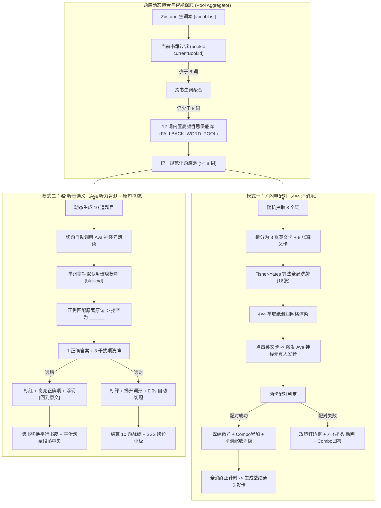

# ⚡ 单词闯关双模式游戏引擎与保底题库调度指南 (Word Game Workshop & Fallback Pool)

> 适用场景：背单词/语言学习应用中，用户容易产生审美疲劳或遗忘曲线执行阻力。通过将枯燥的生词本升级为“4×4 羊皮纸温润卡片闪电配对消除（单词消消乐）”与“微软 Edge Ava 神经元听音 + 原著例句正则挖空盲猜（听力选义）”双模式游戏化实训，并辅以 12 词高质量哲思保底词库，彻底解决新用户 0 生词冷启动痛点。

---

## 1. 核心业务流程与设计范式



---

## 2. 题库动态聚合与 12 词核心保底池 (Fallback Pool)

### 2.1 零生词冷启动困境与对策
若用户刚导入新书或首次打开阅读器，生词本为空。若无保底机制，游戏页面将直接崩溃或展示空卡片。
**设计策略**：
1. **范围开关**：支持 `[📖 当前书籍生词]` vs `[📚 全部生词本]`；
2. **两级级联兜底**：
   - 优先取当前书生词；
   - 若不足 8 词，自动合并全部生词本；
   - 若总数仍不足 8 词，自动并入 `FALLBACK_WORD_POOL`（去重匹配，大小写不敏感）；
3. **保证题库容量 $\ge 8$**，达成 100% 秒开即玩。

### 2.2 规范化数据接口与保底词库定义
```typescript
export interface NormalizedGameWord {
  id: string;
  word: string;
  translation: string;
  context: string;
  bookTitle: string;
  bookId?: string;
  paragraphIndex?: number;
  isFallback?: boolean;
}

// 12 个高质量哲思与原著高频词汇
export const FALLBACK_WORD_POOL: NormalizedGameWord[] = [
  {
    id: "fallback-fulfillment",
    word: "fulfillment",
    translation: "成就感/实现",
    context: "True fulfillment comes from internal mastery rather than external validation.",
    bookTitle: "世界小史 (A Little History of the World)",
    isFallback: true,
  },
  {
    id: "fallback-combative",
    word: "combative",
    translation: "好斗的/好辩的",
    context: "A combative approach rarely yields peaceful understanding between civilizations.",
    bookTitle: "世界小史 (A Little History of the World)",
    isFallback: true,
  },
  {
    id: "fallback-conflict-averse",
    word: "conflict-averse",
    translation: "回避冲突的",
    context: "Being conflict-averse often postpones necessary confrontations with reality.",
    bookTitle: "世界小史 (A Little History of the World)",
    isFallback: true,
  },
  {
    id: "fallback-prioritize",
    word: "prioritize",
    translation: "划分优先级",
    context: "Wise leaders learn to prioritize collective well-being over transient impulses.",
    bookTitle: "世界小史 (A Little History of the World)",
    isFallback: true,
  },
  {
    id: "fallback-instrumental",
    word: "instrumental",
    translation: "工具性的/手段的",
    context: "Language became an instrumental tool in uniting dispersed communities.",
    bookTitle: "世界小史 (A Little History of the World)",
    isFallback: true,
  },
  {
    id: "fallback-introspection",
    word: "introspection",
    translation: "内省/自省",
    context: "Philosophical introspection allows us to examine the nature of historical motives.",
    bookTitle: "世界小史 (A Little History of the World)",
    isFallback: true,
  },
  {
    id: "fallback-autonomy",
    word: "autonomy",
    translation: "自主权/独立性",
    context: "The quest for moral autonomy was at the heart of early modern revolutions.",
    bookTitle: "世界小史 (A Little History of the World)",
    isFallback: true,
  },
  {
    id: "fallback-affiliation",
    word: "affiliation",
    translation: "归属感/联结",
    context: "A strong sense of social affiliation bound the early tribes together against hardship.",
    bookTitle: "世界小史 (A Little History of the World)",
    isFallback: true,
  },
  {
    id: "fallback-tranquility",
    word: "tranquility",
    translation: "宁静/平和",
    context: "Monks sought inner tranquility amidst the chaotic turmoil of medieval Europe.",
    bookTitle: "世界小史 (A Little History of the World)",
    isFallback: true,
  },
  {
    id: "fallback-resilient",
    word: "resilient",
    translation: "有韧性的/适应力强的",
    context: "The human spirit proved exceptionally resilient across centuries of famine and conflict.",
    bookTitle: "世界小史 (A Little History of the World)",
    isFallback: true,
  },
  {
    id: "fallback-contemplate",
    word: "contemplate",
    translation: "沉思/深思",
    context: "Scholars gathered under ancient arches to contemplate the mysteries of the universe.",
    bookTitle: "世界小史 (A Little History of the World)",
    isFallback: true,
  },
  {
    id: "fallback-enlighten",
    word: "enlighten",
    translation: "启蒙/阐明",
    context: "Thinkers strove to enlighten minds through reason and scientific inquiry.",
    bookTitle: "世界小史 (A Little History of the World)",
    isFallback: true,
  },
];
```

---

## 3. 子模式一：⚡ 闪电配对（4×4 单词消消乐）算法与交互实现

### 3.1 卡片结构与 Fisher-Yates 洗牌
```typescript
interface MatchCard {
  id: string; // 格式: `en-${wordId}` 或 `zh-${wordId}`
  wordId: string;
  type: "en" | "zh";
  text: string;
  word: string; // 用于发音
  isMatched: boolean;
}

function shuffleArray<T>(array: T[]): T[] {
  const result = [...array];
  for (let i = result.length - 1; i > 0; i--) {
    const j = Math.floor(Math.random() * (i + 1));
    [result[i], result[j]] = [result[j], result[i]];
  }
  return result;
}
```

### 3.2 匹配判定与高保真发音逻辑
1. **即触点读**：当用户点击 `type === 'en'` 的卡片时，立即调用 `playWordAudio(card.word)` 直连微软 Edge Ava 神经元人声，呈现琥珀金选中态。
2. **二元配对**：
   - 当点击第 2 张卡片时，执行判定：`firstCard.wordId === secondCard.wordId && firstCard.type !== secondCard.type`；
   - **成功**：
     ```typescript
     setMatchCombo((c) => {
       const next = c + 1;
       setMaxMatchCombo((m) => Math.max(m, next));
       return next;
     });
     // 触发翡翠绿高亮并在 320ms 后平滑消隐
     setTimeout(() => {
       setMatchedIds(newMatchedSet);
       setSelectedMatchIds([]);
       if (newMatchedSet.size >= matchCards.length) {
         setIsMatchTimerActive(false);
         setIsMatchVictory(true);
       }
     }, 320);
     ```
   - **失败**：
     ```typescript
     setMatchCombo(0); // 连击归零
     setWrongMatchIds([firstCard.id, secondCard.id]); // 触发玫瑰红边框与 CSS 抖动
     setTimeout(() => {
       setWrongMatchIds([]);
       setSelectedMatchIds([]);
     }, 520);
     ```

### 3.3 CSS 左右抖动动画
```css
@keyframes card-shake {
  0%, 100% { transform: translateX(0); }
  20%, 60% { transform: translateX(-5px); }
  40%, 80% { transform: translateX(5px); }
}
.animate-card-shake {
  animation: card-shake 0.45s ease-in-out;
}
```

---

## 4. 子模式二：🎧 听音选义（Ava 神经元听力 + 原句挖空盲猜）

### 4.1 切题自动朗读与毛玻璃遮罩
1. **切题自动发音**：每当索引 `currentIndex` 更新时，自动触发：
   ```typescript
   setTimeout(() => {
     playWordAudio(quizQuestions[nextIndex].targetWord.word);
   }, 150);
   ```
2. **纯听力毛玻璃模糊**：
   - 单词拼写默认添加样式：`blur-md select-none text-foreground/40`；
   - 只有当用户主动点击 `[👀 看一眼词形]` 或完成作答后，才平滑过渡到 `filter-none select-text`。

### 4.2 正则原句语境安全挖空
防止特殊正则字符注入破坏，并实现全局忽略大小写匹配替换：
```typescript
const renderClozeContext = (context: string, word: string, reveal: boolean) => {
  if (!context?.trim()) return "（暂无原句收录，请结合释义推测）";

  // 转义正则保留字符
  const escapedWord = word.replace(/[-/\\^$*+?.()|[\]{}]/g, "\\$&");
  const regex = new RegExp(`(${escapedWord})`, "gi");
  const parts = context.split(regex);

  return (
    <span>
      {parts.map((part, idx) => {
        if (part.toLowerCase() === word.toLowerCase()) {
          return reveal ? (
            <span key={idx} className="font-bold underline decoration-emerald-500 text-emerald-600 dark:text-emerald-400 bg-emerald-500/10 px-1 py-0.5 rounded">
              {part}
            </span>
          ) : (
            <span key={idx} className="font-bold underline decoration-amber-500 text-amber-600 dark:text-amber-400 font-mono bg-amber-500/10 px-1.5 py-0.5 rounded tracking-widest">
              ______
            </span>
          );
        }
        return <span key={idx}>{part}</span>;
      })}
    </span>
  );
};
```

### 4.3 答错跨书精准平滑穿梭
当用户选错时，底部浮现 `[🔗 回到原文]` 按钮。点击后执行跨书平行切换并精确定位：
```typescript
const handleJumpToSource = (paragraphIndex?: number, targetBookId?: string, targetBookTitle?: string) => {
  if (typeof paragraphIndex !== "number") {
    toast.info("💡 此词为预置典藏哲思词汇，可在正文阅读中自由探索更多例句");
    setActiveTab("reader");
    return;
  }

  // 1. 若所属书籍与当前正在阅读的书籍不一致，先无感切换书籍
  if (targetBookId && currentBookId !== targetBookId) {
    switchBook(targetBookId);
    toast.info(`📖 已为您自动切换至《${targetBookTitle || "原著书籍"}》`);
  }

  // 2. 切回阅读主界面并翻页
  setActiveTab("reader");
  goToParagraphIndex(paragraphIndex);

  // 3. 延迟 150ms 等待 DOM 挂载完成，平滑滚动至视口中央偏上
  setTimeout(() => {
    const el = document.getElementById(`paragraph-${paragraphIndex}`);
    if (el) {
      el.scrollIntoView({ behavior: "smooth", block: "center" });
    }
    setActivePlayingIndex(paragraphIndex);
    setTimeout(() => {
      if (useReaderStore.getState().activePlayingIndex === paragraphIndex) {
        setActivePlayingIndex(null);
      }
    }, 3500);
  }, 150);
};
```

---

## 5. 最佳实践与避坑契约 (Gotchas)

1. **移动端手势解锁与发声并发**：
   - 切换题目时的自动发音在移动端 iOS Safari 下可能受到 Autoplay 策略拦截。必须在外层统一的 `playWordAudio` 中同步执行 `warmupAudioContext()`，并在异常时静默降级为原生 SpeechSynthesis，绝不阻塞 UI 渲染。
2. **生词本双向快捷穿梭**：
   - 生词本 (`VocabularyView.tsx`) 顶部操作区与空状态卡片内均需植入醒目的琥珀金按钮 `[⚡ 去玩单词闯关]`，点击即执行 `setActiveTab("wordgame")`，消除不同功能模块间的认知孤岛。
3. **连击 Combo 与时间戳仲裁**：
   - 闪电配对中，连击数应由父级状态统一管理并在连续成功时触发缩放动效；若判定失败，立即重置连击为 0，并设置短暂的冷却防抖时间（520ms），防止用户在抖动期间胡乱连点导致状态死锁。
